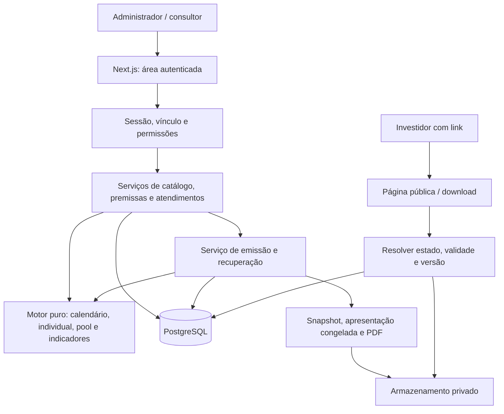

# Plataforma Comercial Hoteleira — desenho formal da beta

* **Author:** Cláudio Más
* **Status:** Approved — desenho formal e plano detalhado aprovados pelo solicitante; homologação comercial pendente
* **Date:** 2026-11-11
* **Updated:** 2026-11-13

Documento iniciado a partir do [brief aprovado](concepts_brief.md), publicado como [RFC](docs/designs/plataforma-comercial-hoteleira-beta-rfc.md). O solicitante autorizou a publicação do RFC seguida da elaboração deste desenho, aprovou o primeiro bloco (Overview, The Problem, Goals e Non-Goals) e escolheu a opção TypeScript/Next.js e PostgreSQL. Em 2026-11-13, aprovou também o bloco técnico, incluindo jornadas e requisitos de operação, a seção de alternativas e o plano detalhado com suas dependências auxiliares. A versão formal é salva em `docs/designs/plataforma-comercial-hoteleira-beta.md`, no destino escolhido pelo solicitante.

O [desenho do piloto, revisão 1](<Desenho do piloto - Plataforma comercial hoteleira.md>) é a base funcional. O [plano de implementação, revisão 1](<Plano de implementacao - Plataforma comercial hoteleira.md>) é uma proposta técnica anterior; seus arquivos e serviços ainda não existem. Este documento incorpora as recomendações conceituais aprovadas e distingue as decisões já aprovadas das condições operacionais ainda por confirmar.

Em 2026-11-18, o solicitante autorizou iniciar a implementação pelo P01, com dados controlados.

## Overview

A Plataforma Comercial Hoteleira apoiará equipes que comercializam unidades de condo-hotéis no Brasil. O consultor conduz a simulação durante o atendimento e compartilha uma proposta por link e PDF. O investidor consulta o material sem criar conta. O administrador mantém os dados comerciais, as regras e as premissas oficiais de cada empreendimento.

O MVP será uma versão beta anterior à etapa SaaS. O investimento no SaaS já está decidido. A finalidade da beta é colocar o produto na rotina da primeira empresa parceira, substituir gradualmente a planilha e identificar necessidades adicionais a partir do uso real. A empresa confirmou disponibilidade total para preparação, homologação, atendimentos acompanhados e feedback; nenhuma necessidade adicional ao desenho atual foi relatada até aqui.

A entrada em uso começará por um empreendimento, com expansão após validação dos cálculos e do atendimento. A base documental permite outras empresas beta por convite do operador da plataforma, com dados separados. Isso não implica cadastro público nem cobrança de assinaturas nesta etapa.

Os modelos individual e pool permanecem no escopo. O primeiro empreendimento utilizará pool com participação proporcional aos valores de venda de referência, registrados nas premissas publicadas. Alterações de preço e descontos não mudarão automaticamente essa participação. Para o primeiro cliente, o payback será apresentado com 24 meses descontados, com identificação da regra e exibição também do prazo simples. Essas são decisões existentes, não novas escolhas deste rascunho.

## The Problem

A planilha atual concentra cadastro de unidades, tarifas, despesas, ocupação e estimativas apresentadas ao investidor. A empresa precisa transformar essa função comercial em um fluxo que permita manter premissas oficiais, conduzir atendimentos e consultar o conteúdo exato de cada proposta emitida.

Essa substituição exige distinguir conceitos que podem parecer equivalentes durante uma venda: unidades disponíveis comercialmente, inventário da operação hoteleira e participantes do rateio do pool. Também exige separar o preço negociado do peso de participação e diferenciar uma previsão do ano completo de um resultado de período parcial. O sistema deve comunicar essas diferenças tanto a quem configura o empreendimento quanto a quem apresenta o resultado.

A aplicação deve preservar propostas já emitidas quando preços, disponibilidade, regras ou premissas forem atualizados. Emissão interrompida, conflito de atualização e restauração de backup precisam ter um caminho de recuperação que conserve o histórico e as restrições dos links. Uma falha não pode transformar uma tentativa incompleta em proposta acessível nem liberar novamente, sem conferência, um link revogado ou substituído.

A planilha será uma fonte histórica e de comparação, sujeita às pendências de homologação já identificadas no desenho do piloto. O objetivo é reproduzir as regras comerciais confirmadas, sem copiar fórmulas defeituosas ou presumir que seus dados representam o inventário completo do pool.

O sucesso da beta será demonstrado pela capacidade de a equipe executar os atendimentos necessários e adotar a plataforma como referência do empreendimento. O feedback orientará correções e evolução do produto; não se trata de reavaliar a decisão de investir no SaaS nem de entregar automaticamente todos os pedidos antes de concluir a beta.

## Goals

1. **Substituir gradualmente a planilha nos atendimentos comerciais.** Permitir que administrador e consultor concluam as tarefas documentadas; identificar uma única referência oficial por empreendimento e formalizar sua adoção após validação pela empresa.

2. **Administrar os dados e as condições oficiais.** Manter identidade da empresa, usuários, empreendimentos, unidades, preços, disponibilidade, condições de pagamento, limites de desconto e validade das propostas. Publicar versões verificadas de calendário, cenários, tarifas, despesas e regras de participação.

3. **Simular os dois modelos com resultados verificáveis.** Calcular operação individual e pool conforme regras predefinidas por empreendimento, incluindo despesas, retenções, custos exclusivos e tratamento de prejuízo quando aplicáveis. Conferir os resultados com referências independentes; não deduzir o inventário ou o denominador do pool somente das unidades à venda.

4. **Explicar resultados e suas limitações.** Comparar cenários otimista, realista e pessimista; permitir cenário personalizado apenas dentro das faixas autorizadas. Distinguir dado ausente de zero, total parcial de indicador anual e payback simples de payback com meses descontados. Apresentar as estimativas e as premissas relevantes em português, com valores em BRL.

5. **Concluir e recuperar o atendimento.** Permitir selecionar unidade, simular desconto autorizado, escolher condição de pagamento, identificar o interessado, salvar rascunho e emitir proposta. Explicar conflitos e próximos passos, preservar dados ainda válidos e destacar mudanças antes de uma nova emissão.

6. **Compartilhar propostas consistentes e preservar seu histórico.** Manter entradas, resultados, premissas e apresentação de cada versão emitida. Tela de consulta e PDF devem conciliar; validade, substituição e revogação devem restringir o acesso conforme o desenho existente. A proposta não reserva a unidade, e geração não equivale a envio pelo consultor.

7. **Respeitar permissões e separação entre empresas.** Administrador e consultor devem ter os acessos documentados. Convites de outras empresas não podem expor dados da parceira ou de outra beta. A consulta do investidor deve se limitar à versão vinculada ao link compartilhado.

8. **Preparar uma operação recuperável.** Demonstrar retomada segura de emissão, recuperação de dados e arquivos e preservação da leitura de propostas antigas após atualizações. Antes de reabrir consulta pública após restauração, conferir ou invalidar os estados de links afetados. Definir contingência e autoridade de pausa e retomada antes de a plataforma se tornar referência oficial.

9. **Aprender com o uso real sem ampliar automaticamente o escopo.** Observar atendimentos, registrar dificuldades e contornos e avaliar separadamente defeitos, configuração, usabilidade e novas funcionalidades. Relacionar ocorrências a referências internas e horário quando disponíveis; o acompanhamento inicial pode ser manual e externo ao produto.

### Evidências de atendimento dos objetivos

A homologação deverá reunir cálculos de referência dos dois modelos, execução dos fluxos administrativos e comerciais, conferência de tela/link/PDF, verificação de permissões e recuperação e validação de atendimentos reais pela empresa. O modelo ainda não usado comercialmente pode ser validado inicialmente com dados controlados, conforme o desenho do piloto.

Os responsáveis combinarão a janela e a quantidade de atendimentos do primeiro balanço e as dificuldades que impedem a adoção. Este documento não presume metas, prazo, capacidade simultânea ou níveis de suporte ainda não acordados. A expansão ocorrerá por empreendimento após a validação; ideias novas poderão continuar no backlog.

## Non-Goals

- Cadastro público de empresas, cobrança de assinaturas SaaS ou ampliação imediata para produtos imobiliários além de condo-hotel no Brasil.
- CRM completo, integrações externas, gestão de comissões ou automação de comunicação aos investidores.
- Assinatura de contratos, aceite eletrônico com efeito de contratação, recebimento de pagamentos ou reserva automática de unidade.
- Gestão da operação de reservas de hospedagem.
- Fórmulas livres, importador genérico de planilhas ou busca automática de feriados externos.
- TIR, VPL, valorização do imóvel, reinvestimento ou payback datado que considere obra, parcelas e sazonalidade. Encargos de pagamento não serão presumidos sem regra definida.
- Novos módulos de analytics, rastreamento de abertura de propostas ou sistema próprio de feedback nesta beta.
- Reavaliar a decisão de investimento no SaaS ou condicionar a conclusão da beta à implementação de todas as sugestões da empresa.
- Sincronização permanente com a planilha ou uso de duas bases simultaneamente como referência oficial.

## Open Questions

| Ponto ainda aberto | Momento de definição |
|---|---|
| Empreendimento inicial, responsável pela homologação e aprovadores das premissas | Antes da preparação dos dados reais. |
| Consultores participantes, agenda, canal de feedback e primeiro balanço | Antes dos primeiros atendimentos acompanhados; a disponibilidade da empresa já está confirmada. |
| Inventário completo, despesas, calendário e demais parâmetros reais do primeiro pool | Na homologação, antes de publicar o empreendimento para uso comercial. |
| Critérios operacionais de pausa, retomada, suporte e tolerância a perda de dados e tempo de recuperação | Antes de assumir a referência oficial do empreendimento. |
| Ambiente, contas, orçamento e capacidade observada | Antes da publicação operacional, com ensaio representativo. |

## Critical User Journeys (CUJs)

### CUJ 1: preparar e publicar um empreendimento

- **Given:** administrador autenticado, empresa ativa e cadastros preparados; premissas ainda em rascunho.
- **When:** o administrador informa calendário, cenários, tarifas, despesas e regras e solicita publicação.
- **Then:** dados obrigatórios, calendário, inventário, participação, prejuízo do pool e regra de payback são validados. Pendências impedem publicação e indicam os campos necessários. Uma publicação válida cria versão identificada e imutável, com autor e data. A administração distingue oferta comercial, inventário operacional e participantes do rateio.

### CUJ 2: concluir ou recuperar um atendimento

- **Given:** consultor autenticado, unidade comercialmente disponível e premissas vigentes publicadas.
- **When:** o consultor compara cenários, escolhe condições autorizadas, salva o atendimento e solicita emissão.
- **Then:** o servidor recalcula, valida acesso e condições e publica uma única versão pronta por solicitação idempotente. Link e PDF representam o mesmo conteúdo. Mudanças concorrentes indicam o que precisa ser revisto; falhas técnicas preservam o rascunho e permitem tentativa controlada. A proposta anterior continua válida até a substituição ser concluída.

### CUJ 3: consultar uma proposta compartilhada

- **Given:** investidor com o link de uma versão, sem conta na plataforma.
- **When:** abre a proposta ou solicita seu PDF.
- **Then:** versão ativa e válida permite consulta e download do documento emitido. Versão vencida, revogada ou substituída mostra apenas o estado e o contato previstos, sem valores ou PDF. Token inexistente recebe resposta genérica. O link anterior não redireciona automaticamente para o atual.

### CUJ 4: impedir acesso entre empresas ou consultores

- **Given:** duas empresas e usuários com vínculos e papéis distintos.
- **When:** um usuário tenta consultar ou alterar registros de outra empresa, ou um consultor tenta acessar atendimento de outro consultor.
- **Then:** o serviço recusa a operação antes de devolver dados ou produzir efeitos. O administrador conserva a consulta às propostas de sua empresa. Alterar identificadores no navegador não muda o contexto autorizado.

### CUJ 5: recuperar operação e preservar acesso histórico

- **Given:** emissão interrompida, atualização de formato persistido ou necessidade de restaurar backup.
- **When:** o responsável executa o procedimento correspondente em ambiente controlado antes da liberação operacional.
- **Then:** a emissão não publica versões duplicadas; propostas antigas continuam legíveis sem recálculo; restauração não reabre consulta pública antes da conferência ou invalidação dos links afetados. Se não houver dados confiáveis para retomar o atendimento, novas emissões permanecem suspensas até a recuperação.

## Technical Plan (Architecture)

### 1. Base escolhida e dependências propostas

A [decisão DT-01](docs/designs/decisao-base-tecnologica-beta.md) define TypeScript, React/Next.js em Node.js e PostgreSQL. A aplicação será integrada, com módulos de domínio, serviços e apresentação no mesmo projeto. O cálculo autoritativo não depende do navegador.

As bibliotecas de apoio abaixo preservam a proposta do plano anterior e foram aprovadas com este bloco técnico. As versões serão fixadas no primeiro setup de implementação, depois de conferir APIs e executar a integração mínima. A consulta à documentação sustenta o uso proposto, não comprova uma aplicação já executada.

| Responsabilidade | Proposta deste bloco | Limite de responsabilidade |
|---|---|---|
| Interface e servidor | Next.js App Router em runtime Node, com React e TypeScript | Rotas, formulários e apresentação; serviços próprios validam as regras comerciais. |
| Banco e migrações | PostgreSQL e Drizzle ORM | Persistência, transações e restrições; consultas recebem escopo de empresa validado. |
| Autenticação | Better Auth com adaptador Drizzle e sessões persistidas | Identidade e sessão; vínculos, papéis, propriedade de registros e convites passam pelos serviços do produto. |
| Validação e cálculo | Zod e decimal.js | Entradas explícitas, decimais e regras determinísticas; não executam fórmulas livres. |
| Documentos | pdf-lib e apresentação comum à página externa | Gerar e armazenar os bytes do PDF, com paginação e fontes; não depender de um navegador para renderizar. |
| Verificação futura | Vitest e Playwright | Referências de domínio, integração e jornadas; comandos e arquivos serão enumerados na implementação detalhada. |

O Next.js documenta [servidor Node.js](https://nextjs.org/docs/app/getting-started/deploying) e [autorização na camada de acesso aos dados](https://nextjs.org/docs/app/guides/authentication). Better Auth documenta um [adaptador para Drizzle](https://better-auth.com/docs/adapters/drizzle). Os nomes de pacotes e a configuração usados na implementação devem seguir as versões fixadas, sem copiar imports antigos por suposição.

### 2. Componentes e fluxo de dados

O domínio recebe dados já resolvidos e devolve resultados; não importa autenticação, banco, armazenamento nem React. Os serviços coordenam permissões, revisões e transações. A interface usa os resultados dos serviços, sem uma segunda implementação dos cálculos. Página externa e PDF são derivados da apresentação congelada na emissão.

| Módulo futuro | Localização de referência | Responsabilidade |
|---|---|---|
| Contratos e cálculo | `src/domain/` | Schemas, calendário, despesas, modelos individual/pool, investimento e indicadores. |
| Identidade e banco | `src/server/auth/`, `src/server/db/`, `drizzle/` | Sessões, vínculos, repositórios, restrições e migrações. |
| Administração | `src/server/catalog/`, `src/server/premises/` | Cadastros, condições, rascunhos de premissas, publicação e retirada. |
| Atendimento | `src/server/simulations/` | Rascunhos, cálculo, parcelas e atualização explícita para versões vigentes. |
| Emissão e consulta | `src/server/proposals/` | Snapshot, PDF, links, estados, recuperação e resolução pública. |
| Arquivos e auditoria | `src/server/storage/`, `src/server/audit.ts` | Objetos privados, chaves imutáveis e registro de alterações. |
| Telas e mensagens | `src/app/`, `src/components/`, catálogo pt-BR | Fluxos por papel, estados recuperáveis e textos de interface/documentos. |
| Operação | `scripts/`, `docs/runbooks/` | Convites, carga assistida, diagnóstico, backup, restauração e contingência. |

Esses caminhos descrevem arquivos e módulos a criar. Não representam código existente. A lista exaustiva de arquivos e suas mudanças pertence à etapa de implementação detalhada. A raiz do projeto é este workspace; os caminhos Windows do plano anterior são apenas referências históricas.

### 3. Identidade, permissões e separação entre empresas

O servidor obtém `ActorContext = { userId, companyId, role }` da sessão e de um vínculo ativo. O identificador de empresa enviado num formulário não concede acesso. Cada serviço verifica papel, empresa e propriedade do registro; uma proteção apenas no menu ou no layout não substitui essa verificação.

O administrador mantém cadastros e premissas e consulta propostas da empresa. O consultor consulta o catálogo autorizado e administra seus próprios rascunhos e propostas dentro dos limites publicados. Desativar o vínculo impede o uso autenticado e revoga as sessões correspondentes. Criação e redefinição assistidas exigem troca de senha, sem envio automático de e-mail.

O operador provisiona empresas e seus primeiros administradores por comando de servidor, sem cadastro público ou endpoint genérico de administração global. Não recebe acesso normal aos dados comerciais das empresas. Eventual suporte com dados de cliente depende da autorização e do registro exigidos no desenho do piloto; esta beta não acrescenta um painel de impersonação.

Entidades comerciais carregam `companyId`. Restrições e referências compostas impedem relações entre registros de empresas distintas, além das verificações dos serviços. Os testes futuros devem tentar leitura e escrita cruzadas, inclusive com identificadores forjados e usuários desativados.

### 4. Persistência e versões

| Conjunto de dados | Conteúdo e regras |
|---|---|
| Empresa, usuário e vínculo | Identidade, papel, atividade do vínculo e trilha de provisionamento; credenciais fora do conteúdo de propostas. |
| Empreendimento e unidade comercial | Identificadores estáveis, código único por empreendimento, preço, disponibilidade e condições; alterações relevantes incrementam a revisão do catálogo. |
| Inventário e participantes | Inventário operacional separado das unidades à venda; participantes e pesos abrangem todo o conjunto elegível. Vender uma unidade não retira sua participação automaticamente. |
| Premissas | Rascunho editável e versões publicadas imutáveis; calendário, cenários, tarifas, despesas, participação, prejuízo e payback completos antes da publicação. |
| Interessado e simulação | Nome obrigatório apenas para emitir, telefone/e-mail opcionais; dono, entradas, versões usadas, revisão do rascunho e resultado recuperáveis. |
| Proposta e versão | Série de versões, snapshot e apresentação emitida imutáveis; estado de emissão e estado de acesso mantidos separadamente do conteúdo histórico. |
| Tentativa, link e auditoria | Chave idempotente, andamento recuperável, referência do PDF, token protegido e registro de ações com autor e horário. |

Identificadores de registros usam UUIDs. Datas de calendário são datas civis; emissão e eventos usam timestamps UTC, com o fuso do empreendimento preservado para a validade. Dados monetários são acompanhados da moeda BRL. Cadastros referenciados pelo histórico são arquivados.

As colunas monetárias e pesos seguem a proposta `numeric(30,12)` e taxas `numeric(20,12)`, com limites de entrada compatíveis. Valores decimais trafegam como texto canônico, sem conversão intermediária para ponto flutuante. O Drizzle oferece [tipos numeric/decimal para PostgreSQL](https://orm.drizzle.team/docs/column-types); a configuração concreta deve preservar essa representação.

Premissas publicadas e snapshots terão proteção contra alteração no banco. Estados de emissão, revogação e substituição continuam mutáveis por operações autorizadas e auditadas: preservar o conteúdo não pode impedir revogar um link.

O banco garante unicidade de versão por proposta e empresa e de chave idempotente por empresa. A reserva de número/versão e a confirmação da versão substituída são operações coordenadas no banco; duas emissões concorrentes não podem substituir silenciosamente a mesma versão atual.

### 5. Motor de cálculo e apresentação

O contrato `CalculationInput` seleciona `INDIVIDUAL` ou `POOL`, identifica a versão de regras e exige `PaybackRule`. A validação rejeita calendário sobreposto, percentuais fora de faixa, tarifas necessárias ausentes, participação incompleta e custos com bases ou ordens inválidas. Zero explícito permanece diferente de ausência.

O calendário classifica cada data uma única vez, com precedência de data especial, feriado, final de semana e dia útil. Temporadas, finais de semana e exceções são parâmetros do empreendimento. O ano-base deve conciliar com 365 ou 366 dias; períodos excluídos produzem horizonte parcial. Não se importam como regra as contagens legadas da planilha.

No modelo individual, receitas são derivadas de noites, tarifas e ocupação; custos fixos permanecem quando a receita é zero. No pool, o motor calcula a operação coletiva e as retenções e distribui a parcela conforme participantes publicados. Aplica o tratamento de prejuízo escolhido e os custos exclusivos do investidor. O valor de referência usado como peso não é substituído pelo preço negociado do atendimento.

O investimento total considera preço negociado e custos de aquisição explicitamente informados. O motor calcula retorno anual simples, média mensal simples, payback simples e payback conforme a regra publicada. Para `DEDUCTED_MONTHS`, mantém os dois prazos e a identificação dos meses descontados. Resultado não positivo, investimento inválido e horizonte parcial produzem os motivos de indisponibilidade previstos, em vez de números enganadores.

A precisão de cálculo proposta é de 40 dígitos significativos com decimal.js. A apresentação usa moeda com duas casas e `ROUND_HALF_UP`, retorno com quatro casas percentuais e prazo com duas. Ajustes de centavos são identificados na apresentação quando necessários; não modificam participações. A biblioteca permite [configurar precisão e arredondamento](https://mikemcl.github.io/decimal.js/); os limites e resultados continuam sujeitos às referências independentes do produto.

O resultado registra `engineVersion`, horizonte, cenários e alertas. A proposta preserva valores, textos relevantes e apresentação da emissão; mudanças futuras do catálogo de mensagens não reescrevem seu significado. Custos pendentes e limitações dos indicadores continuam visíveis.

### 6. Publicação de premissas e edição do atendimento

Salvar um rascunho incompleto é permitido; publicar exige validação completa do modelo correspondente. A publicação compara a revisão esperada e gera uma nova versão. Retirar uma versão impede novas emissões, preserva os documentos anteriores e permite localizar as propostas afetadas para decisão manual da equipe.

Um rascunho comercial registra `expectedCatalogRevision`, `expectedPremiseVersionId` e sua própria revisão. O servidor resolve preços, participação, faixas e condições a partir da base autorizada. Alterações concorrentes não são absorvidas silenciosamente: o consultor recebe o motivo, atualiza explicitamente o atendimento e confere o que mudou antes de emitir. Campos ainda válidos são preservados.

O cronograma de pagamento deve conciliar com o preço negociado; eventual centavo residual é identificado. Não se presumem juros ou correção. Limite de desconto não configurado equivale a zero, e faixas não configuradas desabilitam o cenário personalizado.

### 7. Emissão consistente entre banco e PDF

Não existe uma transação única abrangendo PostgreSQL e armazenamento de arquivos. O serviço só libera acesso depois de preparar o documento e confirmar as condições comerciais numa transação final curta. O protocolo proposto é:

1. **Preparar.** Validar usuário, vínculo, propriedade, revisões, premissas vigentes, disponibilidade, desconto e condições. Recalcular no servidor e preparar o conteúdo e a validade da proposta.
2. **Reservar a tentativa.** Em transação curta, alocar número/versão, completar snapshot e apresentação imutáveis e persistir a emissão `PENDING`, chave idempotente e identidade da solicitação. A mesma chave e o mesmo conteúdo recuperam a mesma emissão para o usuário autorizado; conteúdo diferente gera conflito, sem reutilizar documentos indevidos.
3. **Produzir o PDF.** Renderizar a apresentação e gravar um objeto privado de chave imutável. Não manter transação aberta durante geração ou upload. Identificar o objeto pela tentativa para permitir diagnóstico e limpeza posterior.
4. **Confirmar.** Revalidar as revisões, o acesso, as condições e a versão atual da proposta numa transação final. Se continuarem válidos, associar o PDF, tornar a emissão `READY` e substituir a versão anterior de forma coordenada. Outra substituição concorrente ou mudança comercial gera conflito, conserva a versão vigente e exige revisão do atendimento.
5. **Entregar.** Devolver número, versão, estado e link somente para a emissão pronta. O PDF é preservado; downloads não o regeneram a partir de dados atuais.
6. **Recuperar.** Falha deixa estado consultável `PENDING` ou `FAILED`, com etapa e código de ocorrência. Uma nova tentativa autorizada retoma o trabalho conforme seu estado, sem publicar duplicatas. Objetos sem referência válida podem ser removidos pelo procedimento operacional.

A retomada proposta permanece no serviço da aplicação e pode ser acionada pelo usuário ou responsável autorizado. O banco controla a posse temporária da execução e identifica a tentativa atual; um executor que perdeu essa posse não pode concluir a emissão nem remover o arquivo de outro. O prazo de suspeita de interrupção e os limites de tentativa são configurações operacionais definidas a partir do ensaio. Não é necessário introduzir uma fila externa para esse protocolo na beta.

Erros técnicos não apagam os dados válidos do rascunho. Se uma condição comercial mudou, repetir a mesma chave não autoriza recalcular e sobrescrever o snapshot da tentativa antiga: a interface conduz a atualização explícita e uma nova solicitação. A recuperação conserva uma única responsabilidade pelo avanço dos estados.

O PDF usa paginação, acentos, fontes e imagens validadas, com tamanho de conteúdo considerado no ensaio. A API do [pdf-lib permite serializar o documento em bytes](https://pdf-lib.js.org/docs/api/classes/pdfdocument#save); o layout, a coerência dos valores e a integração com armazenamento são responsabilidades a verificar na aplicação.

### 8. Consulta pública, tokens e validade

O token usa 32 bytes aleatórios. O banco guarda hash SHA-256 para resolução e cópia cifrada com AES-GCM para recuperação autenticada do link. A chave de cifra fica no servidor e tem procedimento próprio de recuperação. O token completo não entra em logs, métricas ou registros manuais de feedback.

| Estado resolvido | Resposta externa |
|---|---|
| Ativa, pronta e dentro da validade | Apresentação emitida e download do PDF correspondente. |
| Vencida | Estado e contato, sem valores nem PDF. |
| Revogada | Estado e contato, sem valores nem PDF. |
| Substituída | Estado e contato, sem valores nem PDF e sem redirecionamento à nova versão. |
| Token inexistente ou inválido | Resposta genérica, sem revelar empresa, interessado ou documento. |

Página e download passam pelo mesmo resolvedor de autorização pública. A validade é registrada como instante final derivado da data civil e do fuso do empreendimento. O arquivo privado não é exposto por URL permanente.

As respostas da proposta e do download são dinâmicas e usam `Cache-Control: no-store`, sem cache no proxy/CDN, com `Referrer-Policy: no-referrer` e `X-Robots-Tag: noindex, nofollow`. Não há analytics, preview com dados pessoais ou rastreamento de abertura. A equipe continua responsável pelo envio nos canais existentes. Revogar o link não remove PDFs já baixados.

### 9. Contratos internos e rotas propostas

Os contratos de serviço reaproveitam os nomes do plano anterior. São interfaces internas do produto, não uma API pública de integração SaaS.

| Contrato | Responsabilidade principal |
|---|---|
| `requireActor` | Resolver sessão, vínculo e contexto de acesso; recusar identidade ou vínculo inválido. |
| `saveDevelopment`, `saveUnit` | Manter catálogo e condições sob autorização administrativa e controle de revisão. |
| `savePremiseDraft`, `publishPremises`, `withdrawPremises` | Separar preparação, publicação imutável e retirada de vigência. |
| `calculate` | Validar e calcular os modelos por um contrato determinístico com versões identificadas. |
| `createDraft`, `updateDraft`, `rebaseDraft` | Persistir atendimento, controlar concorrência e atualizar explicitamente suas referências. |
| `buildSnapshot`, `buildProposalPresentation`, `renderProposalPdf` | Produzir conteúdo congelado e os mesmos valores para página e documento. |
| `issueProposal`, `revokeProposalLink`, `getShareLink` | Emitir com idempotência, controlar acesso e recuperar o link somente para quem tem permissão. |
| `resolvePublicProposal` | Resolver token, estado e validade para página e download. |

As telas autenticadas e suas mutações chamam serviços de servidor. Entradas são validadas e o resultado devolve apenas os campos necessários ao papel. Validações de formulário apontam os campos; conflitos explicam a atualização necessária; falhas inesperadas retornam código de ocorrência sem detalhes sensíveis.

Rotas propostas: `/entrar`, áreas administrativas e comerciais sob sessão, `/api/auth/[...all]` para o mecanismo de identidade, `/p/[token]` para consulta externa e `/p/[token]/pdf` para download. Não haverá endpoint público para cadastrar empresas, confirmar contratação ou reservar unidade. A autenticação não concede autorização comercial por si só.

### 10. Atualizações e recuperação do histórico

Snapshots e apresentação emitida usam versão explícita de formato. Antes de uma alteração incompatível, será verificada a leitura de uma proposta da versão anterior e declarado se o código anterior ainda pode operar sobre os dados migrados. Preferir mudanças aditivas; não recalcular propostas antigas para adaptá-las a uma regra nova. O PDF emitido permanece o documento da sua versão.

O procedimento de restauração suspende o acesso público antes de restaurar banco e arquivos. Esse bloqueio pertence ao ambiente de operação, e não pode depender de uma flag que volte ao valor antigo junto do backup. O ensaio deve incluir uma revogação e uma substituição posteriores ao ponto restaurado, além de conferir snapshot e bytes do PDF.

Antes de reabrir a consulta pública, reconciliar as restrições posteriores ao backup com registros confiáveis disponíveis. Se não for possível demonstrar o estado de um conjunto de links restaurados, invalidá-los antes de retomar; a equipe precisará compartilhar novas versões pelo fluxo normal. Essa alternativa tem custo de reemissão e comunicação manual, mas não exige presumir que o backup conserva alterações posteriores a sua criação.

Na adoção por empreendimento, a empresa identifica a referência oficial e quem autoriza suspensão e retomada. O retorno temporário à planilha exige conferir dados atuais; quando ela não puder representar as condições vigentes, novas emissões ficam suspensas até a recuperação. Não se cria sincronização permanente entre as duas ferramentas.

## Alternatives Considered

Esta seção deriva de Alternatives Weighed no [brief aprovado](concepts_brief.md), das abordagens do [desenho do piloto](<Desenho do piloto - Plataforma comercial hoteleira.md>) e da [decisão DT-01](docs/designs/decisao-base-tecnologica-beta.md). Registra escolhas e avaliações já realizadas; não acrescenta alternativas para uma nova votação de arquitetura.

### A. Trocar todos os empreendimentos simultaneamente

- **Benefício:** padronizar a ferramenta em uma única transição, reduzindo o período em que empreendimentos diferentes usam referências diferentes.
- **Custo e limite:** concentrar cadastros, homologação de regras, treinamento e correções antes de qualquer entrada em uso. Um problema comum afeta toda a implantação de uma vez.
- **Decisão e motivo:** não selecionada pelo solicitante no desenho do piloto. A implantação gradual escolhida permite validar um empreendimento antes de ampliar e distribuir a preparação ao longo da adoção.

### B. Emitir propostas somente em PDF

- **Benefício:** reduzir o compartilhamento a um arquivo, sem página externa e resolução de estado por token.
- **Custo e limite:** o arquivo já enviado não acompanha revogação, substituição ou validade controlada pela plataforma. É necessário um canal consultável para aplicar os estados de acesso previstos ao link.
- **Decisão e motivo:** não selecionada, pois o solicitante escolheu expressamente link com PDF. O link aplica os controles de consulta, e o PDF preserva o documento da versão; cópias já baixadas continuam fora do alcance da revogação.

### C. Usar Python/Django e PostgreSQL

- **Benefício:** reaproveitar os mecanismos de autenticação e administração interna descritos em DT-01, mantendo a possibilidade de uma aplicação integrada e um domínio de cálculo independente.
- **Custo e limite:** adaptar a proposta anterior de módulos, contratos e testes para Python, definir outra integração de PDF e desenvolver as telas dos fluxos comerciais. O admin genérico, isoladamente, não atende às jornadas aprovadas.
- **Decisão e motivo:** alternativa não selecionada pelo autor em DT-01; a escolha expressa foi TypeScript/Next.js e PostgreSQL. O autor não informou justificativa adicional. A continuidade do plano anterior e o custo de adaptação são a avaliação técnica registrada, não um motivo atribuído ao autor.

### D. Separar interface, API e emissão em serviços publicados independentemente

- **Benefício:** permitir dimensionamento, publicação e manutenção separados quando houver necessidades distintas entre os componentes.
- **Custo e limite:** acrescentar comunicação entre serviços, configuração de acesso, coordenação de versões e recuperação operacional. Não há carga medida ou equipe separada que justifique esse custo nesta beta.
- **Decisão e motivo:** não adotada no bloco técnico aprovado. A aplicação integrada conserva limites internos entre domínio, serviços e apresentação, sem exigir serviços independentes. Uma separação futura depende de evidência operacional; não é requisito da primeira implantação.

### E. Construir feedback e analytics dentro do produto

- **Benefício:** centralizar relatos e automatizar parte das evidências de uso.
- **Custo e limite:** criar telas, permissões, armazenamento e manutenção para um processo que pode começar com um canal externo e registro manual. Não há demanda conhecida que exija essa automação. Rastreamento de abertura do investidor também não faz parte do escopo.
- **Decisão e motivo:** excluída desta beta pelo escopo aprovado. O acompanhamento usa referências internas e horários quando disponíveis, com classificação e retorno dos pedidos fora de um novo módulo do produto. A disponibilidade total da empresa permite essa dinâmica sem impor automação.

### F. Adiar um dos modelos ou suas regras para reduzir a beta

- **Benefício:** diminuir a quantidade inicial de caminhos de cálculo, cadastro e verificação.
- **Custo e limite:** retirar parte da cobertura funcional já confirmada pelo solicitante. Um primeiro empreendimento em pool não elimina o requisito do modelo individual nem autoriza remover regras documentadas.
- **Decisão e motivo:** não adotada; o brief e os blocos aprovados preservam ambos os modelos. A implantação gradual permite validar inicialmente o modelo ainda não usado comercialmente com dados controlados, sem confundir essa validação com homologação de dados reais.

### G. Ampliar a beta para um SaaS genérico desde o início

- **Benefício:** disponibilizar antecipadamente cadastro público, cobrança e maior variedade de produtos e integrações.
- **Custo e limite:** ampliar a superfície de implementação antes de aparecerem necessidades concretas do primeiro uso. Isso também dilui o trabalho de substituir a planilha e acompanhar atendimentos reais.
- **Decisão e motivo:** não adotada nesta etapa, conforme os limites aprovados. Preservam-se convites, separação entre empresas, moeda identificada, tipo de produto e regras versionadas; cobrança SaaS, integrações e outros produtos continuam fora da beta. Essa delimitação não reabre a decisão de investir no SaaS.

### H. Sincronizar permanentemente planilha e plataforma

- **Benefício:** permitir à equipe continuar usando ambas as ferramentas durante a transição.
- **Custo e limite:** precisar definir autoridade de cada campo, resolver alterações concorrentes e mapear versões e regras entre estruturas diferentes. Sem esses mecanismos, preço, disponibilidade ou premissas podem divergir e gerar duas referências concorrentes.
- **Decisão e motivo:** não adotada no escopo e na contingência aprovados. Cada empreendimento tem uma referência oficial identificada. Uso temporário da planilha exige conferência dos dados vigentes, e pode ser inviável até a recuperação da plataforma; não implica manter uma segunda base sincronizada.

As escolhas históricas e a aprovação do bloco técnico têm alcances distintos: não se atribuem ao autor justificativas que ele não informou, nem rejeições de bibliotecas ou provedores que não foram comparados. Hospedagem, contas e limites operacionais permanecem nas questões abertas. Nenhuma alternativa acima autoriza uma contratação ou alteração dos documentos históricos.

## Non-Functional Requirements

- **Segurança e privacidade:** validar permissões no servidor, proteger sessão/origem e limitar tentativas de login; segredos fora do código; uploads com validação de conteúdo e limite de tamanho; arquivos privados; logs e códigos de ocorrência sem dados pessoais, credenciais ou tokens públicos.
- **Diagnóstico:** registrar operação, horário, identificadores internos, versões, resultado e etapa de emissão quando aplicáveis. Tornar emissões interrompidas e último backup bem-sucedido consultáveis pelo responsável autorizado. Usar avisos simples do ambiente, sem exigir ferramentas de análise no produto ou plantão permanente.
- **Capacidade:** medir duração do cálculo e da emissão, memória, consultas e tamanho dos arquivos com inventário e concorrência representativos. Limites operacionais precisam produzir respostas recuperáveis. Hospedagem, orçamento, capacidade simultânea e metas de latência continuam sem valores inventados.
- **Persistência e restauração:** verificar banco, PDF e restrições de acesso no ambiente efetivo; manter homologação separada; executar testes e restauração apenas em destinos isolados. Tolerância a perda de dados, tempo de recuperação e agenda de backup serão combinados antes da adoção oficial.
- **Manutenção:** manter domínio independente e contratos versionados; preservar históricos e definir migrações antes de alterar formatos persistidos. Limpeza de órfãos não pode apagar PDFs ou ativos ainda referenciados por documentos históricos.

### Verificação prevista para as recomendações aprovadas

| Recomendação do brief | Evidência esperada no produto e na homologação |
|---|---|
| R1 — contingência | Ensaio de pausa/retomada com referência oficial, responsável e conferência dos dados. |
| R2 — restauração dos links | Backup anterior a revogação/substituição não permite reabertura pública indevida. |
| R3 — emissão recuperável | Interrupção após upload, retry concorrente e conflito comercial preservam uma versão pronta coerente e a anterior até substituição válida. |
| R4 — histórico legível | Proposta emitida antes de atualização conserva valores, textos relevantes e PDF. |
| R5 — clareza do fluxo | Administrador distingue os três conjuntos do pool; consultor compreende conflitos e continua com dados válidos preservados. |
| R6 — diagnóstico | Relato manual pode ser associado a uma ocorrência interna sem copiar dados do investidor ou o link público. |
| R7 — capacidade e custo | Ensaio registra tempos e consumo representativos; acompanhamento inclui arquivos, banco, transferência e backups. |
| R8 — acompanhamento | Registro manual diferencia atendimento, emissão, reemissão, envio e interrupção; primeiro balanço tem janela e amostra combinadas. |

Essas são verificações futuras, não resultados de testes executados. As condições comerciais e os dados reais continuam sujeitos à homologação documentada.

## Detailed Implementation Plan

### Alcance e convenções de execução

Este é um plano para construção posterior, na raiz deste workspace. Não autoriza executar a implementação, publicar o serviço ou contratar infraestrutura nesta etapa documental. O desenho original, o plano anterior, o RFC, o brief e o XLSX permanecem como fontes históricas; a aplicação não altera nem interpreta fórmulas do XLSX.

Os quinze pacotes abaixo constituem uma única sequência de implementação. Cada tabela enumera os arquivos do pacote e a finalidade de cada um. Todos estão previstos como **Create**, pois não há implementação de produto identificada. Não há exclusões previstas. Ao executar um pacote, confirmar antes se algum arquivo passou a existir e preservar alterações legítimas; diferenças materiais exigem atualizar o manifesto. Arquivos gerados de instalação e build, segredos locais, PDFs emitidos e backups são artefatos de execução, não código a versionar.

Os caminhos entre crases são relativos à raiz e representam arquivos futuros. Não são links para implementações existentes. Os nomes de migrações e metadados abaixo são os nomes planejados para a primeira migração; se a versão fixada do gerador produzir nomes diferentes, registrar os nomes efetivos no manifesto antes de aplicá-la. Não editar um snapshot gerado para simular uma migração que não ocorreu.

Além das bibliotecas do bloco técnico, o detalhamento explicita auxiliares de implementação: `@aws-sdk/client-s3` para o adaptador de arquivos, `@pdf-lib/fontkit` para fontes incorporadas, `server-only` para proteger importações de servidor e `pdfjs-dist` apenas no desenvolvimento para conferir o conteúdo dos PDFs. São dependências de apoio aprovadas pelo solicitante junto com este plano em 2026-11-13. Fixar versões compatíveis e registrar o lockfile; não pressupor que a documentação consultada comprova a integração.

O [pdf-lib exige fontkit para fontes personalizadas](https://pdf-lib.js.org/#embed-font-and-measure-text). As fontes propostas são Noto Sans regular e bold, com bytes e licença copiados de uma revisão identificada do [repositório de fontes](https://github.com/notofonts/noto-fonts/tree/main/hinted/ttf/NotoSans), sem download durante a emissão. O [PDF.js documenta uso como biblioteca e exemplos em Node](https://mozilla.github.io/pdf.js/examples/). Essas consultas sustentam os auxiliares propostos, não acrescentam funções para o usuário final.

### Contratos que a implementação deve preservar

| Contrato | Definição necessária |
|---|---|
| `DecimalText`, `CivilDate` | Texto decimal canônico e data civil válida `YYYY-MM-DD`; dinheiro nunca é transportado como `number`. Taxas usam frações entre zero e um. |
| `CalculationInput` | União por `model`, com calendário, períodos, cenários, investimento e `PaybackRule`; `INDIVIDUAL` acrescenta unidade/noites/tarifas/custos; `POOL` acrescenta inventário, participantes, perdas, retenções e custos do investidor. |
| `Participation` | Percentuais contratuais conciliados ou pesos com base e valores de referência publicados; bases `LIST_PRICE`, `AREA`, `IDEAL_FRACTION` e `MANUAL`. Pesos desconhecidos não viram zero. |
| `PaybackRule`, `Metric` | `SIMPLE` ou `DEDUCTED_MONTHS` com inteiro positivo; resultado disponível ou motivo `PARTIAL_YEAR`, `NON_POSITIVE_RESULT`, `INVALID_INVESTMENT` ou `RECOVERED_WITHIN_DEDUCTION`. |
| `CalculationResult` | `engineVersion`, horizonte, indicador de ano completo, cenários, períodos, totais, despesas discriminadas, participação, retorno, payback escolhido e simples e alertas. |
| `ActorContext` | `userId`, `companyId` e papel resolvidos pelo servidor a partir de sessão e vínculo ativo. |
| `DraftCommand` | Empreendimento, unidade, revisões esperadas, desconto, condição, interessado, horizonte e eventual cenário personalizado; não recebe resultados financeiros prontos. |
| `DraftDTO` | Entradas, dono, revisão do rascunho, referências utilizadas, resultado e desatualização; inclui referência da emissão em andamento para recuperar uma tentativa após recarregar a tela. |
| `ProposalSnapshot` | Formato versionado com empresa, empreendimento, unidade, consultor, interessado, condições, versões de catálogo/premissas/motor, entradas e resultados, número, versão, emissão, validade, fuso, contatos e ativos imutáveis. |
| `ProposalPresentation` | Formato versionado com seções, textos e valores já preparados para exibição, inclusive motivos de indisponibilidade; persistido na emissão e consumido por página e PDF. |
| `IssueCommand`, `IssuedProposalDTO` | Rascunho, revisão esperada, chave idempotente e versão substituída; retorno com emissão, número, versão e estado. Link somente quando pronto e para usuário autorizado. |
| `FileStore` | `putImmutable`, `get` e `deleteOrphan`; o serviço decide a elegibilidade para apagar, o adaptador executa a operação. Bytes têm MIME, tamanho e hash conferíveis. |

Os comandos administrativos e DTOs correspondentes serão definidos no serviço proprietário, com schemas compartilhados entre ação de servidor e serviço. Erros têm código estável, campos e código de ocorrência quando aplicável. A integração não devolve stack, SQL, segredos ou token público no erro.

### Sequência única de implementação

#### P01 — configuração, contratos e precisão

Preparar ferramentas e contratos antes de importar regras em telas. Declarar em `package.json` os scripts indicados ao final desta seção. Configurar testes unitários sem banco e testes de integração com configuração separada; o build completo só será exigido após existir a aplicação do P13.

| Ação | Arquivo | Conteúdo e motivo |
|---|---|---|
| Create | `package.json` | Dependências, versão de Node suportada pela combinação fixada e scripts reproduzíveis. |
| Create | `package-lock.json` | Fixar a resolução efetivamente instalada. |
| Create | `tsconfig.json` | Verificação estrita, aliases e fronteiras de compilação do projeto. |
| Create | `next-env.d.ts` | Declarações geradas pelo Next, sem edição manual de tipos. |
| Create | `next.config.ts` | Publicação Node e inclusão dos ativos locais necessários ao PDF. |
| Create | `eslint.config.mjs` | Regras compatíveis com Next/TypeScript e restrição de importações do domínio para servidor/UI. |
| Create | `.gitignore` | Excluir segredos, armazenamento, relatórios locais, dependências e builds. |
| Create | `.env.example` | Nomes das configurações, exemplos identificados como desenvolvimento e nenhum segredo real. |
| Create | `vitest.config.ts` | Descobrir somente testes unitários e seus aliases. |
| Create | `vitest.integration.config.ts` | Runner com banco de teste e setup separado; execução de integração explícita. |
| Create | `playwright.config.ts` | Servidor e projetos de navegador para jornadas responsivas controladas. |
| Create | `drizzle.config.ts` | Schema e diretório de migrações; não aplicar migrações automaticamente no carregamento da aplicação. |
| Create | `src/domain/contracts.ts` | Tipos compartilhados de entradas, regras e resultados descritos acima. |
| Create | `src/domain/schemas.ts` | Validação discriminada, limites numéricos e campos obrigatórios, distinguindo ausência de zero. |
| Create | `src/domain/errors.ts` | Erros de domínio e associação aos campos sem dependência de HTTP. |
| Create | `src/domain/money.ts` | Parse pt-BR, decimal canônico e apresentação com a política aprovada. |
| Create | `tests/unit/money.test.ts` | Precisão, arredondamento e rejeição de entrada ambígua. |
| Create | `tests/unit/schemas.test.ts` | Limites, regras incompletas e diferenças entre zero, ausência e valor inválido. |

**Verificação do pacote:** `1.234,56` vira `1234.56`; texto inválido é recusado; `0.1 + 0.2` apresenta `0.30` e `1.005` apresenta `1.01`. Ocupação maior que um e meses descontados não inteiros/positivos são recusados. Rodar os testes unitários afetados e typecheck; não executar banco ou build antes de existirem seus pré-requisitos.

#### P02 — calendário e horizonte

| Ação | Arquivo | Conteúdo e motivo |
|---|---|---|
| Create | `src/domain/calendar.ts` | `buildCalendar`: datas civis, temporadas, precedência, contagens por período e ano completo. |
| Create | `fixtures/reference/calendar.ts` | Calendários controlados de anos comuns, bissextos e períodos divididos. |
| Create | `tests/unit/calendar.test.ts` | Exclusividade de classificação, sobreposição, lacunas e reconciliação das contagens. |

**Verificação do pacote:** 2026 totaliza 365 dias e 2024, 366; especial prevalece sobre feriado; fim de semana é configurável; março dividido concilia; período excluído impede indicadores anuais; indisponibilidade de noites não altera por si a duração do ano-base. Não somar milissegundos em horários locais para gerar datas civis.

#### P03 — despesas, operação individual e indicadores

| Ação | Arquivo | Conteúdo e motivo |
|---|---|---|
| Create | `src/domain/costs.ts` | Custos fixos/percentuais, base explícita, ordem de aplicação e retenções. |
| Create | `src/domain/individual.ts` | Receitas por noites, tarifas e ocupação; resultados por período da unidade. |
| Create | `src/domain/metrics.ts` | Investimento, retornos e ambos os paybacks, com motivos de indisponibilidade. |
| Create | `fixtures/reference/individual.ts` | Referência independente com receitas e custos verificáveis. |
| Create | `tests/unit/costs.test.ts` | Bases, ordem, saldo positivo, despesas fixas e rejeição de dependências inválidas. |
| Create | `tests/unit/individual.test.ts` | Operação completa, receita zero, custos persistentes e horizonte parcial. |
| Create | `tests/unit/metrics.test.ts` | Retornos simples, regra de meses descontados e estados sem valor. |

**Verificação do pacote:** 365 noites, diária `500`, ocupação `0.8`, custo fixo anual `18000` e administração `0.15` geram receita `146000.00`, custos `39900.00` e resultado `106100.00`. Investimento `600000` produz payback simples `67.86` e, descontando 24 meses, `43.86`. Ocupação zero conserva resultado `-18000.00`; ano parcial não anualiza. A diferença de 24 meses é conferida antes do arredondamento.

#### P04 — pool e distribuição

| Ação | Arquivo | Conteúdo e motivo |
|---|---|---|
| Create | `src/domain/pool.ts` | Operação coletiva, retenções, participação e resultado do investidor. |
| Create | `src/domain/calculate.ts` | Entrada pública única do motor, escolhendo o modelo sem dependência de persistência. |
| Create | `fixtures/reference/pool.ts` | Inventário e participantes controlados, incluindo unidade fora da oferta comercial. |
| Create | `tests/unit/pool.test.ts` | Denominador completo, pesos, perdas, custos exclusivos e ajustes de apresentação. |

**Verificação do pacote:** dez unidades nas condições do P03, custo fixo coletivo anual `180000` e taxa `0.15` geram receita `1460000.00`, distribuível `1061000.00` e parcela de `106100.00` para participação `0.1`. Pesos `498000` e `628000` usam denominador `1126000`. Alterar desconto ou disponibilidade comercial não muda o rateio publicado. Percentuais incompletos e soma de pesos zero são recusados. Prejuízo `-100` gera parcela `-10` em repasse proporcional e distribuição zero em absorção, preservados déficit e custos exclusivos.

#### P05 — banco, revisões e isolamento

Criar schema relacional com conteúdos versionados validados como JSON quando forem agregados de premissas e propostas. Publicações e snapshots não são coleções de campos livremente editáveis após emissão. Separar o conteúdo imutável dos ponteiros e estados de acesso.

| Ação | Arquivo | Conteúdo e motivo |
|---|---|---|
| Create | `compose.yaml` | PostgreSQL local de desenvolvimento/teste, sem apontar para dados operacionais. |
| Create | `src/server/env.ts` | Validar ambiente, origens, banco, armazenamento, chave de links e limites operacionais. |
| Create | `src/server/db/client.ts` | Conexão, transações e fronteira de uso exclusivo no servidor. |
| Create | `src/server/db/schema/auth.ts` | Tabelas requeridas pela configuração efetiva do Better Auth e troca obrigatória de senha. |
| Create | `src/server/db/schema/company.ts` | Empresa, vínculo ativo, papéis e contador de propostas por empresa. |
| Create | `src/server/db/schema/catalog.ts` | Empreendimentos, unidades, condições, disponibilidade e revisão de catálogo. |
| Create | `src/server/db/schema/premises.ts` | Rascunhos, versões publicadas, inventário/participantes e referência de vigência. |
| Create | `src/server/db/schema/simulations.ts` | Interessados, dono, entradas, resultado e revisão de rascunho. |
| Create | `src/server/db/schema/proposals.ts` | Série, versões, emissões, tentativas e links com restrições de unicidade e empresa. |
| Create | `src/server/db/schema/audit.ts` | Eventos de alteração com contexto e dados mínimos, sem segredos. |
| Create | `src/server/audit.ts` | `appendAudit` na mesma transação da mudança que será registrada. |
| Create | `drizzle/0000_beta.sql` | Primeira migração: tabelas, índices, referências compostas e proteção dos conteúdos imutáveis. |
| Create | `drizzle/meta/0000_snapshot.json` | Metadados gerados para reprodução da primeira migração. |
| Create | `drizzle/meta/_journal.json` | Registro de migrações compatível com a ferramenta fixada. |
| Create | `tests/support/database.ts` | Criar/limpar somente banco isolado, com guarda do destino e conexões independentes para concorrência. |
| Create | `tests/support/setup-integration.ts` | Verificar ambiente de teste antes de migrar ou limpar dados. |
| Create | `tests/integration/schema.test.ts` | Referências cruzadas, imutabilidade, unicidade e separação de bases. |

**Regras de schema:** referências comerciais incluem empresa e identificador. Unicidade de unidade é por empreendimento; de versão, por série/empresa; de chave idempotente, por empresa; de hash do token, global. A série guarda o ponteiro para a versão pronta atual. Emissões guardam dono, rascunho, fingerprint da solicitação e estado; tentativas guardam contador crescente, posse temporária, etapa, objeto e erro. Número e versão são reservados atomicamente e não reutilizados após falha; lacunas não significam proposta emitida.

**Verificação do pacote:** migrar banco vazio; recusar vínculos entre empresas; impedir alteração de conteúdo publicado e permitir operações autorizadas sobre estados separados. A guarda compara o destino efetivo do banco, e não somente a grafia de URLs, e impede usar a base operacional em integração. Testes concorrentes usam conexões reais distintas, não mocks das transações.

#### P06 — autenticação e provisionamento por convite

| Ação | Arquivo | Conteúdo e motivo |
|---|---|---|
| Create | `src/server/auth/config.ts` | Better Auth, adaptador Drizzle, sessões de banco, origem e cadastro público desativado. |
| Create | `src/server/auth/context.ts` | `requireActor` e autorização por papel/vínculo sem confiar no payload. |
| Create | `src/server/auth/users.ts` | Criar, desativar e redefinir acesso da equipe dentro da empresa. |
| Create | `src/app/api/auth/[...all]/route.ts` | Integração do mecanismo de identidade com o Next. |
| Create | `src/app/(auth)/entrar/page.tsx` | Entrada da equipe com mensagens recuperáveis. |
| Create | `src/app/(auth)/trocar-senha/page.tsx` | Fluxo obrigatório após credencial inicial ou redefinida. |
| Create | `src/app/(auth)/actions.ts` | Adaptação de formulários de identidade, sem regras comerciais no navegador. |
| Create | `scripts/bootstrap-admin.ts` | Provisionar a empresa parceira e seu primeiro administrador. |
| Create | `scripts/invite-company.ts` | Criar empresa beta e primeiro administrador por comando do operador. |
| Create | `tests/integration/auth.test.ts` | Sessões, papéis, redefinição, desativação e convites isolados. |

**Contexto da sessão:** armazenar a referência do vínculo ativo na sessão e revalidá-la no servidor. Com um vínculo permitido, a entrada é direta; se houver mais de um, o próprio fluxo de entrada apresenta somente os vínculos retornados ao usuário autenticado e persiste a seleção após conferi-la. A escolha enviada pelo navegador nunca cria permissão. Enquanto houver troca obrigatória de senha pendente, permitir somente o fluxo de identidade necessário para concluí-la.

**Verificação do pacote:** sessão ausente recusa acesso; consultor não administra equipe; vínculo inativo impede operações; `companyId` forjado não troca empresa; senha inicial exige troca e redefinição revoga sessões. Com duas empresas convidadas, conferir catálogo, premissas, equipe e propostas em leitura e escrita. Scripts usam entrada/configuração segura para credenciais, sem imprimi-las nem registrá-las em argumentos de log.

#### P07 — catálogo, identidade da empresa e arquivos

| Ação | Arquivo | Conteúdo e motivo |
|---|---|---|
| Create | `src/server/catalog/contracts.ts` | Comandos e DTOs de empresa, empreendimento, unidade, desconto e pagamento. |
| Create | `src/server/catalog/service.ts` | Cadastro, identidade comercial, arquivo lógico e incremento de revisão. |
| Create | `src/server/storage/contract.ts` | Interface privada e tipos de objeto/hash/MIME. |
| Create | `src/server/storage/local.ts` | Adaptador de desenvolvimento com gravação exclusiva e caminhos confinados. |
| Create | `src/server/storage/s3.ts` | Adaptador S3 com bucket privado e proteção contra sobrescrita. |
| Create | `src/server/storage/index.ts` | Selecionar adaptador por configuração validada. |
| Create | `src/app/(staff)/admin/empresa/page.tsx` | Identidade, marca e contatos comerciais da empresa. |
| Create | `src/app/(staff)/admin/equipe/page.tsx` | Gestão administrativa de usuários e vínculos. |
| Create | `src/app/(staff)/admin/empreendimentos/page.tsx` | Listagem e criação de empreendimentos. |
| Create | `src/app/(staff)/admin/empreendimentos/[id]/page.tsx` | Unidades, preços, disponibilidade e condições do empreendimento. |
| Create | `src/app/(staff)/admin/actions.ts` | Ações finas de administração que resolvem o ator e delegam aos serviços. |
| Create | `tests/integration/catalog.test.ts` | Permissões, revisões, condições, arquivos e conservação do histórico. |
| Create | `tests/integration/storage.test.ts` | Imutabilidade de objeto, falhas de leitura/gravação e isolamento dos adaptadores. |

**Regras e verificação:** desconto ausente permite zero; exceção por unidade é explícita; condições devem conciliar com o preço. Alterações de preço/disponibilidade incrementam a revisão de forma transacional. Upload aceita PNG/JPEG/WebP de até 5 MB, com validação dos bytes e sem buscar URLs arbitrárias. Objeto já existente não é sobrescrito: conferir hash para reconhecer repetição idêntica ou recusar diferença. A implementação S3 usa a precondição documentada de [gravação condicional](https://docs.aws.amazon.com/AmazonS3/latest/userguide/conditional-writes.html), cuja disponibilidade deve ser ensaiada no provedor efetivo. Não presumir que um mock prova compatibilidade de todo serviço S3.

#### P08 — publicação das premissas

| Ação | Arquivo | Conteúdo e motivo |
|---|---|---|
| Create | `src/server/premises/contracts.ts` | Schemas e DTOs de rascunho, publicação e retirada. |
| Create | `src/server/premises/service.ts` | Validar e publicar versões, controlar vigência e localizar propostas afetadas. |
| Create | `src/app/(staff)/admin/empreendimentos/[id]/premissas/page.tsx` | Preparar calendário, cenários, custos, inventário e participantes com revisão antes da publicação. |
| Create | `src/components/premises-form.tsx` | Campos e resumo que distinguem operação, participantes e oferta comercial. |
| Create | `tests/integration/premises.test.ts` | Publicação incompleta, concorrência, retirada e independência do catálogo. |

**Contratos:** `savePremiseDraft`, `publishPremises(actor, draftId, expectedRevision)` e `withdrawPremises(actor, versionId, reason)`. Publicação bloqueia a referência de vigência do empreendimento para impedir duas versões concorrentes com a mesma revisão. A retirada altera vigência e auditoria, não o conteúdo da versão histórica. Sem regra de payback, pesos completos, calendário ou política de prejuízo não há publicação. Testar que nova tabela de preços não altera participações já publicadas.

#### P09 — rascunhos e simulação do atendimento

| Ação | Arquivo | Conteúdo e motivo |
|---|---|---|
| Create | `src/server/simulations/contracts.ts` | Comandos/DTOs, revisões esperadas e referência de emissão recuperável. |
| Create | `src/server/simulations/service.ts` | Criar, atualizar e recalcular rascunhos com propriedade e versões verificadas. |
| Create | `src/server/simulations/payments.ts` | Datas e parcelas determináveis com conciliação do preço. |
| Create | `src/app/(staff)/simulacoes/page.tsx` | Atendimentos acessíveis ao ator com estados de atualização. |
| Create | `src/app/(staff)/simulacoes/nova/page.tsx` | Seleção de empreendimento/unidade e início do atendimento. |
| Create | `src/app/(staff)/simulacoes/[id]/page.tsx` | Cenários, condições, interessado e recuperação do rascunho. |
| Create | `src/app/(staff)/simulacoes/actions.ts` | Validar comandos de formulário e chamar serviços autorizados. |
| Create | `tests/integration/simulations.test.ts` | Dono, concorrência, troca de unidade, faixas e condições. |

**Verificação do pacote:** outro consultor não abre o rascunho; revisão antiga gera conflito; troca de unidade refaz referências sem reaproveitar participação/custos indevidos. Cenário personalizado não sobrescreve oficiais. Atualização explícita destaca diferenças e preserva dados válidos. Parcelas conciliam com ajuste identificado na última, sem presumir juros/correção. Reiniciar a aplicação conserva o atendimento.

#### P10 — snapshot, apresentação e PDF

| Ação | Arquivo | Conteúdo e motivo |
|---|---|---|
| Create | `src/server/proposals/contracts.ts` | Comandos de emissão, snapshot, apresentação versionada e respostas públicas. |
| Create | `src/server/proposals/snapshot.ts` | Construir conteúdo a partir de fontes autorizadas e validar sua completude. |
| Create | `src/server/proposals/presentation.ts` | Preparar e congelar seções, valores e textos compartilhados pelos renderizadores. |
| Create | `src/server/proposals/pdf.ts` | PDF A4 paginado e independente de Chromium, com fontes e imagens incorporadas. |
| Create | `src/server/proposals/fonts.ts` | Carregar fontes locais e registrar fontkit sem chamadas de rede na emissão. |
| Create | `src/components/proposal-content.tsx` | Exibir a apresentação persistida, sem cálculo ou reformatação por regras atuais. |
| Create | `src/i18n/pt-BR.ts` | Textos de interface/documentos e motivos de estado em catálogo único. |
| Create | `src/i18n/index.ts` | Acesso tipado às mensagens na preparação de novas apresentações. |
| Create | `assets/fonts/NotoSans-Regular.ttf` | Fonte incorporada para texto legível e acentos. |
| Create | `assets/fonts/NotoSans-Bold.ttf` | Peso de destaque da mesma família. |
| Create | `assets/fonts/OFL.txt` | Preservar o texto da licença que acompanha os ativos. |
| Create | `assets/fonts/README.md` | Registrar origem, revisão e hashes das fontes incorporadas. |
| Create | `fixtures/reference/proposal.ts` | Propostas controladas com nomes longos, acentos, perdas e dados pendentes. |
| Create | `tests/support/pdf-text.ts` | Extração de texto do PDF com PDF.js, sem virar dependência da consulta pública. |
| Create | `tests/unit/proposal-pdf.test.ts` | Comparar conteúdo efetivo do PDF com a apresentação congelada. |

**Verificação do pacote:** conferir preço, três cenários oficiais e eventual quarto personalizado, resultado, investimento, participação, número, versão e validade extraindo texto dos bytes produzidos. Conferir `DEDUCTED_MONTHS`, prazo simples e mensagem de recuperação dentro dos meses descontados. Revisar visualmente páginas com nomes extensos, acentos, ausência de imagem e quebra de página. Não gerar PDF a partir de HTML ou valores recebidos prontos do navegador. Futuras alterações de mensagens não mudam a apresentação já persistida.

#### P11 — emissão, recuperação e acesso autenticado às propostas

| Ação | Arquivo | Conteúdo e motivo |
|---|---|---|
| Create | `src/server/proposals/repository.ts` | Reserva de número/versão, unicidade, bloqueios e transição final consistente. |
| Create | `src/server/proposals/issue.ts` | Coordenar preparação, reserva, PDF e confirmação conforme o protocolo aprovado. |
| Create | `src/server/proposals/recovery.ts` | Posse temporária, tentativas, retomada e identificação de órfãos. |
| Create | `src/server/proposals/links.ts` | Tokens aleatórios, hash, cifra, recuperação autorizada e revogação. |
| Create | `src/server/proposals/validity.ts` | Transformar a data final e o fuso em limite de validade persistido. |
| Create | `src/app/(staff)/propostas/page.tsx` | Histórico filtrado pela empresa e pelo papel/dono. |
| Create | `src/app/(staff)/propostas/[id]/page.tsx` | Versões, estado de emissão, cópia de link e revogação autorizada. |
| Create | `src/app/(staff)/propostas/actions.ts` | Adaptar emissão, retomada e revogação aos serviços. |
| Create | `tests/support/failing-store.ts` | Falhas e barreiras controladas no armazenamento para testar interrupções reais do protocolo. |
| Create | `tests/integration/issuance.test.ts` | Idempotência, disputas de versão, conflitos e confirmação final. |
| Create | `tests/integration/issuance-recovery.test.ts` | Reinício, posse vencida, executor antigo e limpeza protegida. |

**Reserva e concorrência:** calcular o fingerprint a partir do comando normalizado, contexto do dono e revisões solicitadas. Após verificar o direito de acesso, procurar a chave existente antes de recalcular: mesma chave e comando de uma emissão pronta devolvem sua referência original, mesmo que o rascunho ou catálogo tenham evoluído; isso não autoriza reemitir nem alterar o documento. Conteúdo diferente conflita. Na reserva nova, usar unicidade e transação para obter ou criar a emissão, alocar número/versão e congelar conteúdo. Na confirmação, bloquear os registros de autorização e estado relevantes numa ordem estável, com IDs ordenados dentro do mesmo grupo; conferir vínculo, catálogo, premissas, rascunho, série atual e tentativa antes de atualizar o ponteiro. Escritas de preços, vigência e desativação devem coordenar os mesmos registros para não contornar a conferência. Transação nenhuma atravessa geração ou upload.

**Retomada:** cada aquisição de posse incrementa um contador; a chave do objeto pertence à tentativa, cujo registro existe antes do upload. A confirmação exige o contador atual. Executor antigo não conclui depois de perder a posse. Recuperação não adota objeto já marcado para limpeza; cria outra tentativa e chave. Limpeza marca a tentativa de forma coordenada, confere referências e preserva objetos de versões prontas ou tentativas ativas. O armazenamento só apaga depois dessa decisão. Duração da posse, limite de tentativas e concorrência são configurações positivas validadas, com valores de produção definidos pelo ensaio, sem depender do relógio do navegador.

**Validade e links:** token de 32 bytes aleatórios em base64url, hash SHA-256 e cifra autenticada AES-256-GCM com IV aleatório; a cifra vincula empresa e versão para evitar troca de envelopes. Datas são convertidas uma vez no servidor. Internamente, `expiresAt` é o início exclusivo do dia seguinte à data final no fuso escolhido, e acesso exige `now < expiresAt`; a apresentação conserva a data final inclusiva. Usar a conversão de fuso do PostgreSQL e testar a fronteira, sem depender do fuso do processo Node. A documentação descreve [operações de datas e AT TIME ZONE](https://www.postgresql.org/docs/current/functions-datetime.html).

**Verificação do pacote:** duas chamadas da mesma chave retornam uma emissão; chave com outro conteúdo conflita. Dois comandos substituindo a mesma versão não tornam ambos atuais. Mudança de preço, venda, retirada de premissas, revisão do rascunho ou desativação antes da confirmação impede publicação. Falha após upload não libera link; retomada não duplica versão; executor com posse antiga é recusado; limpeza não apaga PDF referenciado. A versão anterior permanece vigente até existir substituta pronta.

#### P12 — página externa e download controlado

| Ação | Arquivo | Conteúdo e motivo |
|---|---|---|
| Create | `src/server/proposals/public.ts` | Resolvedor único de token, prontidão, estado e validade. |
| Create | `src/app/p/[token]/page.tsx` | Consulta responsiva da apresentação emitida ou do estado restrito. |
| Create | `src/app/p/[token]/pdf/route.ts` | Download do objeto autorizado, sem URL permanente ou recálculo. |
| Create | `tests/integration/public-proposal.test.ts` | Token, estados, fuso, headers e ausência de conteúdo indevido. |

**Verificação do pacote:** token ativo funciona sem sessão; inexistente não revela identidade; vencido/revogado/substituído não contém valores nem bytes do PDF. Página e download usam o mesmo instante e resolvedor. Testar validade no último instante do dia e no início do seguinte, inclusive fuso diferente do processo. Aplicar `no-store`, `no-referrer` e `noindex, nofollow`; conferir também proxy e logs no ambiente efetivo. Versão antiga não redireciona à nova. Não adicionar confirmação de leitura.

#### P13 — integração das telas e jornadas

| Ação | Arquivo | Conteúdo e motivo |
|---|---|---|
| Create | `src/app/layout.tsx` | Estrutura global, idioma pt-BR e carregamento dos estilos. |
| Create | `src/app/globals.css` | Legibilidade, comparação de cenários e adaptação aos tamanhos de tela. |
| Create | `src/app/page.tsx` | Entrada que encaminha ao fluxo de login ou área autenticada. |
| Create | `src/app/not-found.tsx` | Resposta genérica para recurso não encontrado. |
| Create | `src/app/error.tsx` | Falhas recuperáveis sem exposição de detalhes técnicos sensíveis. |
| Create | `src/app/(staff)/layout.tsx` | Exigir sessão e compor navegação de acordo com o papel. |
| Create | `src/app/(staff)/page.tsx` | Acesso aos empreendimentos e atendimentos autorizados, sem novos indicadores de analytics. |
| Create | `src/components/app-shell.tsx` | Navegação e identidade comercial compartilhadas. |
| Create | `src/components/money-field.tsx` | Entrada monetária pt-BR acessível, preservando texto validável. |
| Create | `src/components/scenario-comparison.tsx` | Comparar resultados com horizonte, unidades e motivos explícitos. |
| Create | `src/components/simulation-form.tsx` | Campos do atendimento e conservação de entradas após conflitos. |
| Create | `src/components/issue-controls.tsx` | Estado de emissão e chave idempotente estável durante uma solicitação e suas repetições. |
| Create | `tests/e2e/admin-flow.spec.ts` | Configurar, corrigir pendências e publicar premissas. |
| Create | `tests/e2e/commercial-flow.spec.ts` | Simular, salvar, emitir, copiar link, baixar PDF e recuperar conflitos. |
| Create | `tests/e2e/access-isolation.spec.ts` | Papéis, consultores distintos e empresas convidadas. |
| Create | `tests/e2e/public-proposal.spec.ts` | Consulta anônima e estados após revogação/substituição. |

**Verificação do pacote:** executar as cinco CUJs com dados controlados. O navegador não inventa nova chave em cada retry da mesma intenção; após recarregar, recupera a emissão associada ao rascunho autorizado. Conferir 1440 px, tablet e 390 px, teclado, nomes extensos, erros de campo, perda do pool e ausência de imagem. O administrador distingue os três conjuntos do pool. Geração da proposta e envio efetivo continuam ações distintas. Rodar build, typecheck, lint e os E2E afetados após a integração.

#### P14 — referências legadas e homologação assistida

| Ação | Arquivo | Conteúdo e motivo |
|---|---|---|
| Create | `fixtures/reference/legacy-comparison.json` | Aritmética legada controlada, com origem e limites explícitos. |
| Create | `fixtures/reference/pilot-pool-input.json` | Estrutura de coleta marcada como não homologada até receber os dados reais completos. |
| Create | `scripts/prepare-initial-data.ts` | Validar carga assistida de dados preparados sem interpretar XLSX nem publicar automaticamente. |
| Create | `tests/integration/reference-cases.test.ts` | Conferir referências individuais e do pool sem transformar pendência real em teste aprovado. |
| Create | `docs/runbooks/homologacao.md` | Responsáveis, dados, cálculos independentes e evidências antes do uso real. |
| Create | `docs/runbooks/implantacao-gradual.md` | Referência oficial, entrada de cada empreendimento, primeiro balanço e adoção. |
| Create | `docs/runbooks/feedback-beta.md` | Canal, registro manual, triagem, decisões e definições de atendimento/emissão/envio. |

**Verificação do pacote:** FINAL 07 usa receita `93145.03`, resultado `61173.28`, payback simples `97.69` e prazo `73.69` com 24 meses descontados. O calendário de 366 dias da origem é representado em fixture sintética de 2024, identificada como teste; não é definição do ano real. Esse caso não homologa o pool. O caso do primeiro empreendimento permanece pendente até receber inventário, despesas e regras aprovados; uma condição pendente não pode ser contada como aceite. Conferir fevereiro, fim de semana, diárias do FINAL 03 e os textos exigidos no desenho antes da publicação real. O script aceita dados estruturados revisados, com modo de prévia, e nunca modifica o XLSX.

#### P15 — operação, diagnóstico, backup e restauração

| Ação | Arquivo | Conteúdo e motivo |
|---|---|---|
| Create | `Dockerfile` | Imagem Node reproduzível com fontes, build e runtime da aplicação. |
| Create | `.dockerignore` | Excluir segredos, arquivos privados e material de teste da imagem. |
| Create | `src/server/diagnostics.ts` | Logs estruturados com correlação e supressão de dados sensíveis. |
| Create | `src/server/maintenance.ts` | Bloqueio operacional de emissão/consulta que não seja revertido junto de um backup. |
| Create | `src/app/api/health/route.ts` | Saúde sem dados comerciais ou segredos, para verificação do ambiente. |
| Create | `scripts/seed-demo.ts` | Criar apenas dados de demonstração identificados em ambiente permitido. |
| Create | `scripts/diagnose-issuance.ts` | Consultar andamento e falhas pelo identificador interno, sem devolver token ou interessado. |
| Create | `scripts/clean-orphans.ts` | Limpeza com prévia e seleção de tentativas elegíveis pelo serviço de recuperação. |
| Create | `scripts/backup.ts` | Exportar banco e manifesto consistente de objetos privados com hashes. |
| Create | `scripts/restore-check.ts` | Restaurar e ensaiar recuperação somente em banco e armazenamento isolados. |
| Create | `scripts/reconcile-restored-links.ts` | Conferir ou invalidar links restaurados antes da reabertura, com auditoria e prévia. |
| Create | `scripts/measure-beta.ts` | Registrar tempos, memória e tamanho de artefatos em cenários controlados de homologação. |
| Create | `tests/integration/diagnostics.test.ts` | Assegurar localização de falhas sem credenciais, token ou dados pessoais nos registros. |
| Create | `tests/integration/restore.test.ts` | Conteúdo, arquivos, chaves e proteção contra regressão de estado dos links. |
| Create | `tests/integration/historical-proposal.test.ts` | Leitura do formato emitido após mudanças de regras e mensagens. |
| Create | `tests/integration/maintenance.test.ts` | Bloqueio antes de acesso ao conteúdo e independência do estado restaurado. |
| Create | `docs/runbooks/operacao.md` | Contatos, horários, backups, consumo, diagnóstico e dependências do ambiente. |
| Create | `docs/runbooks/restauracao.md` | Destinos, chaves, ensaio e conferência/invalidação dos links antes de reabrir. |
| Create | `docs/runbooks/contingencia.md` | Autoridade de pausa/retomada e condições para usar uma referência alternativa. |
| Create | `docs/runbooks/publicacao.md` | Migrações, homologação separada, bloqueios, logs/proxy e verificações do ambiente efetivo. |
| Create | `README.md` | Setup, execução, scripts, variáveis, limites e acesso aos documentos de operação. |

**Backup consistente:** obter um snapshot de leitura do banco para o dump e para coletar as referências de arquivos do mesmo ponto. Manter a conexão desse snapshot durante o dump; copiar os objetos imutáveis referenciados e conferir tamanho/hash antes de marcar o conjunto como concluído. Backup não concluído não conta como recuperável. Credenciais e chave de cifra são guardadas separadamente dos dados. As ferramentas de banco necessárias são pré-requisitos documentados; não instalar serviços nem contratar armazenamento por iniciativa da execução.

**Restauração:** bloquear tráfego público e novas emissões no ambiente antes de restaurar. A configuração de manutenção é externa ao conjunto restaurado e deve ser verificada também na inicialização. Restaurar em destino isolado, conferir snapshot/PDF e testar backup anterior a uma revogação e a uma substituição. Se registros confiáveis permitirem reconciliar as restrições posteriores ao backup, reaplicá-las; caso contrário, invalidar os links cujo estado não pode ser demonstrado. O modo conservador é invalidar todos os links restaurados. Reabrir somente depois da verificação e autorização operacional; reenviar novas versões pelo fluxo normal quando necessário.

**Diagnóstico e capacidade:** comandos aceitam identificadores internos e usam os serviços autorizados; não são endpoints públicos. Conectar o bloqueio de manutenção ao serviço de emissão e ao resolvedor público antes de ler ou publicar conteúdo; o healthcheck informa manutenção sem revelar dados. Acompanhar última execução bem-sucedida e falhas/ausência de backup, além de saúde e erros de emissão. Registrar a medição do ensaio antes de definir concorrência, duração da posse e tolerâncias de recuperação. Não prometer plantão, custo ou capacidade sem acordo. Testes não usam banco operacional, nem o script de ensaio aceita esse destino.

### Verification Plan

Os comandos abaixo são requisitos para a implementação futura. Não foram executados nesta etapa de redação e não há código de produto declarado aprovado por testes.

| Script previsto | Resultado necessário |
|---|---|
| `npm ci` | Instalação reproduzível após existir o lockfile validado. |
| `npm run test` | Unitários de domínio, precisão e PDF; exclui integração e E2E. |
| `npm run test:integration` | Banco isolado: autorização, revisões, emissão, armazenamento, histórico e restauração. |
| `npm run test:e2e` | Jornadas administrativas, comerciais e públicas nos tamanhos de tela previstos. |
| `npm run typecheck` | Sem erros TypeScript em domínio, serviços, telas e testes. |
| `npm run lint` | Sem violações das fronteiras e regras do projeto. |
| `npm run build` | Build Node completo com os ativos/fontes necessários incluídos. |
| `npm run db:generate`, `npm run db:migrate` | Migração registrada e aplicação em destino deliberadamente escolhido; sem migração automática ao iniciar a aplicação. |
| `npm run bootstrap:admin`, `npm run invite:company` | Provisionamento do operador, sem cadastro público, sem credenciais em logs e com isolamento comprovado. |
| `npm run prepare:initial-data` | Prévia da carga assistida, validação de pendências e nenhuma publicação automática. |
| `npm run seed:demo` | Dados identificados e recusa de ambiente operacional por padrão. |
| `npm run diagnose:issuance`, `npm run clean:orphans` | Diagnóstico mínimo e limpeza com prévia, preservando objetos referenciados/ativos. |
| `npm run backup`, `npm run restore:check` | Conjunto íntegro e restauração demonstrada em destino isolado. |
| `npm run reconcile:links` | Prévia e aplicação auditada das restrições após restauração, com manutenção ativa. |
| `npm run measure:beta` | Evidência representativa de tempos, memória e armazenamento antes da liberação real. |

Cada pacote implementa primeiro os casos que demonstram seu comportamento e executa as verificações apropriadas antes de avançar. Repetir a suíte completa quando houver integração transversal, antes da entrega, ou quando novas mudanças/falhas justificarem. Não criar uma meta percentual de cobertura sem relação com os riscos: a exigência é cobrir as regras, falhas e jornadas explicitadas neste documento.

A liberação comercial exige também os dados reais e responsáveis definidos, o ensaio no ambiente efetivo, a conferência independente dos cálculos e o aceite da empresa para o empreendimento. Resultado de teste com dados controlados não substitui essa homologação nem prova adoção. Este plano foi aprovado para compor o desenho formal em `docs/designs/plataforma-comercial-hoteleira-beta.md`, separado do RFC já publicado. A aprovação documental não declara testes de produto executados nem autoriza, por si, sua implantação operacional.

## Reconciliação final com o brief

Reconciliação realizada em 2026-11-13 pela mesma sessão que redigiu o documento, usando o [brief aprovado](concepts_brief.md). Não foram identificadas contradições de escopo ou decisões pendentes entre o brief e o desenho.

Permanecem preservados a finalidade de uso e feedback da beta, o investimento já decidido no SaaS, os dois modelos, o primeiro pool com pesos pelos valores de referência, o payback com 24 meses descontados e prazo simples, as propostas por link/PDF, a separação entre empresas e as recomendações R1–R8. Os dados reais, os responsáveis, a agenda e o ambiente continuam sujeitos às definições e à homologação indicadas no brief.

| Complemento em relação ao brief | Decisão e aprovação registradas |
|---|---|
| Base tecnológica e componentes | O brief tratava a stack como proposta. O solicitante escolheu TypeScript/Next.js e PostgreSQL em DT-01 e aprovou os componentes e dependências do bloco técnico. |
| Dependências auxiliares | SDK S3, fontkit, proteção de importações de servidor e PDF.js foram explicitados no plano detalhado e aprovados com ele; não representam novos módulos comerciais. |
| Detalhes de interfaces e operação | Seleção de vínculo permitido na entrada, limite de validade exclusivo, recuperação com posse temporária e procedimentos de manutenção foram detalhados nos blocos aprovados. Não criam API pública de integração, cadastro público ou automação de comunicação. |

Não há acréscimo de arquitetura, interface externa ou dependência sem decisão coberta pelas aprovações acima. As alternativas preservam seus motivos e limites, sem atribuir ao autor justificativas que ele não informou. O próximo passo recomendado é uma revisão independente deste desenho com a skill egm-review; a revisão Goldfish anterior avaliou o conceito e não equivale a essa revisão do documento formal.

*Drafted with EGM*
